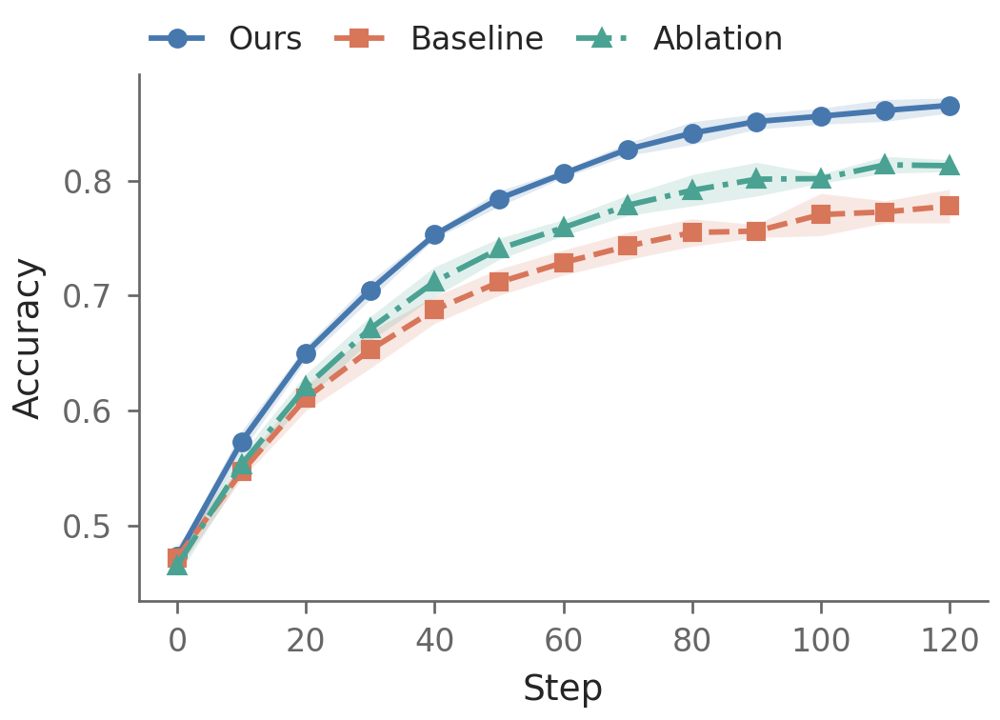

# rendeer

Scientific plots with consistent semantic colors, explicit uncertainty,
composable panels and checks on the rendered canvas. No titles, TeX dependency,
or Matplotlib style changes on import.

```python
import rendeer as rd

fig = rd.line(x=[0, 1, 2], y=[0.61, 0.72, 0.78],
              xlabel="Training step", ylabel="Accuracy")
fig.save("learning.png")
```



Install from the standalone checkout (the distribution has **not** been published to PyPI):

```bash
uv pip install -e '.[stats]'
```

Use an activated uv environment. From the parent LLM4Policy workspace, use
`uv pip install -e '3rd_party/Rendeer[stats]'` instead. The verified
development interpreter is `/scratch/mingyan_root/mingyan/jmtang/env/rendeer-dev/bin/python`.
Run outputs and caches belong on scratch; the example relative export above
is for standalone projects, not an instruction to write outputs into this repo.

Open [`notebooks/test_rendeer.ipynb`](notebooks/test_rendeer.ipynb) for the executed
visual walkthrough. Install `.[dev]` to rerun its figures and regression tests.
Set `RENDEER_SCRATCH_ROOT` to a writable scratch directory before starting
Jupyter on another machine. The notebook detects standalone and nested
checkouts; it writes run outputs beneath that scratch root's `outputs/` directory.

## Compose without redrawing

```python
fig = rd.figure(layout=[["a", "b"], ["c", "c"]], width="double", panel_labels=True)
fig["a"].line(x=[0, 1, 2], y=[0.6, 0.7, 0.8], xlabel="Step", ylabel="Accuracy")
fig["b"].bar(x=["Base", "Full"], y=[0.7, 0.8], xlabel="Model", ylabel="Accuracy")
fig["c"].heatmap([[0.7, 0.8], [0.6, 0.9]], xlabel="Task", ylabel="Model", cbar_label="F1")
```

`fig['a'].ax` and `fig.mpl` expose the original Matplotlib objects. Common plots
also accept an existing `ax=`. Call `fig.validate()` after native customization.

## Statistical meaning is explicit

```python
rd.set_colors({"Ours": "primary", "Baseline": "secondary", "Ablation": "tertiary"})
fig = rd.line(runs, x="step", y="accuracy", hue="method", unit="seed", error="ci95")
```

`runs` is a DataFrame with one observation per independent seed/step/method.
`ci95` is a **pointwise Student-t interval for the mean**, assuming independent,
approximately normal unit values. It is not a simultaneous band. SD, SE and
range are separate choices. Singleton intervals remain unavailable.

## Documentation

- [API and plot grammars](docs/api.md): comparison, distributions, matrices, ML,
  composition, customization and migration.
- [Themes, colors and export](docs/style_and_export.md): configuration,
  dimensions, PNG/PDF, strict checks and limitations.
- [Executable gallery](examples/gallery.py): all supported primitives,
  synthetic learning curves, benchmarks, ablations and compute frontiers.
- [Research and architecture](docs/design_research.md): official sources,
  design conventions and tradeoffs.
- [Contributing and validation](CONTRIBUTING.md) and [release preparation](docs/release.md).

Version 0.1 is an initial reusable implementation, not a promise that every
arbitrary dense figure can be laid out automatically. Strict mode fails known
severe defects; passing checks does not establish scientific validity,
accessibility or publisher acceptance. PNG is the default. PDF requires an
explicit `.pdf` filename or format; other figure formats are rejected.
